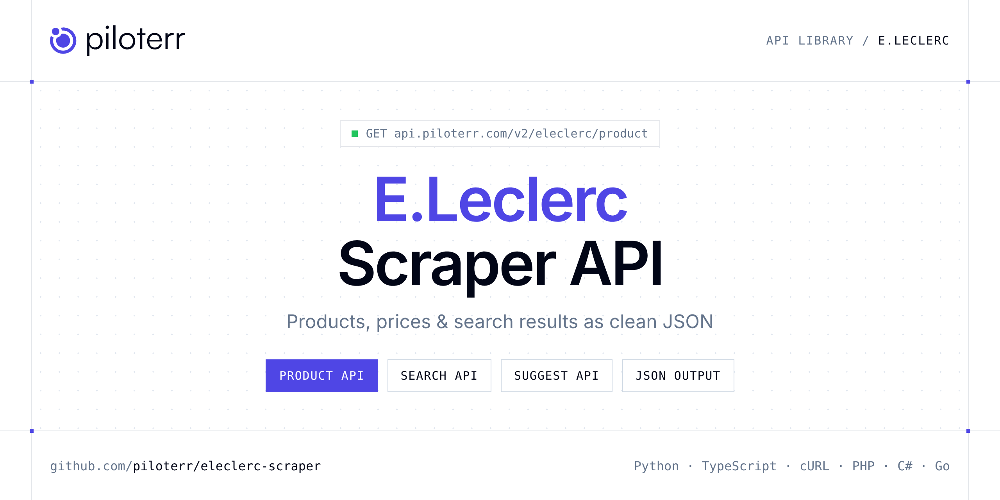

<p align="center">
  <a href="https://www.piloterr.com"></a>
</p>

# E.Leclerc Scraper API

[](https://discord.gg/CFj3ph8aHU) [](https://app.piloterr.com) [](https://app.piloterr.com/openapi) [](LICENSE)

The **Piloterr E.Leclerc Scraper API** lets you extract public data from E.Leclerc as **clean, structured JSON** — no proxies, headless browsers or HTML parsing to maintain. Endpoints available in production:

- **E.Leclerc Product API** — Read one E.Leclerc product by EAN or product URL.
- **E.Leclerc Search API** — Search for products on E.Leclerc by keyword with optional store-specific filtering and pagination.
- **E.Leclerc Suggest API** — Get instant product autocomplete suggestions from E.Leclerc for a given keyword or EAN.

Use it for price monitoring, assortment tracking, competitor analysis, product research or catalog enrichment.

| Endpoint | Path | Credits | What you get |
|---|---|---|---|
| [E.Leclerc Product API](#eleclerc-product-api) | `/v2/eleclerc/product` | 1 | Read one E.Leclerc product by EAN or product URL. Pass store_id to get that store's price and stock. Another store returns a different price and stock. |
| [E.Leclerc Search API](#eleclerc-search-api) | `/v2/eleclerc/search` | 1 | Search for products on E.Leclerc by keyword with optional store-specific filtering and pagination. |
| [E.Leclerc Suggest API](#eleclerc-suggest-api) | `/v2/eleclerc/suggest` | 1 | Get instant product autocomplete suggestions from E.Leclerc for a given keyword or EAN. |

## Table of contents

- [How it works](#how-it-works)
- [E.Leclerc Product API](#eleclerc-product-api)
- [E.Leclerc Search API](#eleclerc-search-api)
- [E.Leclerc Suggest API](#eleclerc-suggest-api)
- [Code examples in other languages](#code-examples-in-other-languages)
- [Practical use cases](#practical-use-cases)
- [Why Piloterr?](#why-piloterr)
- [FAQ](#faq)
- [Related scrapers](#related-scrapers)
- [Support](#support)

## How it works

1. **Create a free Piloterr account** and copy your API key from the [dashboard](https://app.piloterr.com).
2. **Send a `GET` (or `POST`) request** to `https://api.piloterr.com/v2/...` with the header `x-api-key: YOUR_API_KEY`.
3. **Receive structured JSON** — Piloterr handles rendering, proxies, retries and parsing.

```bash
export PILOTERR_API_KEY="your-api-key"
pip install requests        # Python
# TypeScript: Node.js 18+ (native fetch), run with `npx tsx file.ts`
```

> Every endpoint accepts both `GET` (query string) and `POST` (JSON body with the same fields).

## E.Leclerc Product API

Read one E.Leclerc product by EAN or product URL. Pass store_id to get that store's price and stock. Another store returns a different price and stock.

`GET | POST https://api.piloterr.com/v2/eleclerc/product` · **1 credit per request** · [Full reference](https://app.piloterr.com/openapi)

### Request parameters

| Parameter | Type | Required | Description |
|---|---|---|---|
| `query` | string | ✅ | E.Leclerc product EAN or product page URL. |
| `store_id` | string | — | E.Leclerc store sign code. This selects that store's price and stock. |

### Python example

```python
import json
import os
import requests

response = requests.get(
    "https://api.piloterr.com/v2/eleclerc/product",
    headers={"x-api-key": os.environ["PILOTERR_API_KEY"]},
    params={
        "query": "3564700201442",
    },
    timeout=120,
)
response.raise_for_status()
data = response.json()

print(json.dumps(data, indent=2, ensure_ascii=False)[:2000])
```

### TypeScript example

```typescript
type ELeclercProduct = {
  ean?: string;
  brand?: string;
  image?: string;
  offer?: {
    price?: {
      price?: number;
      availability_status?: string;
      offer_availability_status?: string;
    };
    elected_offer?: {
      slug?: string;
      stock?: number;
      shop_id?: string;
      shop_name?: string;
      offer_type?: string;
      national_offer_id?: string;
    };
    cnc_offers_count?: number;
  };
  title?: string;
  data_layer?: {
    id?: string;
    ean?: string;
    name?: string;
    price?: string;
    vendor?: string;
    in_stock?: boolean;
  };
  rating_count?: number;
  rating_average?: number;
};

const params = new URLSearchParams({
  "query": "3564700201442",
});

const response = await fetch(`https://api.piloterr.com/v2/eleclerc/product?${params}`, {
  headers: { "x-api-key": process.env.PILOTERR_API_KEY! },
});
if (!response.ok) throw new Error(`Piloterr error ${response.status}: ${await response.text()}`);

const data = (await response.json()) as ELeclercProduct;

console.log(JSON.stringify(data, null, 2).slice(0, 2000));
```

<details>
<summary><b>POST variant</b></summary>

```http
POST https://api.piloterr.com/v2/eleclerc/product
x-api-key: YOUR_API_KEY
Content-Type: application/json

{"query": "3564700201442"}
```
</details>

### Output example

Example response from the API reference, abridged — real values depend on the page you scrape.

```json
{
  "ean": "5702016367676",
  "brand": "Lego®",
  "image": "https://media.e.leclerc/5702016367676_1",
  "offer": {
    "price": {
      "price": 39.9,
      "availability_status": "En stock",
      "offer_availability_status": "in-stock"
    },
    "elected_offer": {
      "slug": "fp/lego-duplo-rescue-la-caserne-de-pompiers-10903-5702016367676?offerId=m-5702016367676-1017",
      "stock": 1,
      "shop_id": "10171011",
      "shop_name": "E.Leclerc MARENNES",
      "offer_type": "leclerc_store",
      "national_offer_id": "m-5702016367676-1017"
    },
    "cnc_offers_count": 1
  },
  "title": "Lego® Duplo® Rescue - La Caserne De Pompiers - 10903",
  "data_layer": {
    "id": "5702016367676",
    "ean": "5702016367676",
    "name": "Lego® Duplo® Rescue - La Caserne De Pompiers - 10903",
    "price": "39.90",
    "vendor": "E.Leclerc MARENNES",
    "in_stock": true
  },
  "rating_count": 3,
  "rating_average": 5
}
```

### Response fields

| Field | Type | Description |
|---|---|---|
| `ean` | string |  |
| `brand` | string |  |
| `image` | string |  |
| `offer` | object |  |
| `offer.price` | object |  |
| `offer.elected_offer` | object |  |
| `offer.cnc_offers_count` | integer |  |
| `title` | string |  |
| `data_layer` | object |  |
| `data_layer.id` | string |  |
| `data_layer.ean` | string |  |
| `data_layer.name` | string |  |
| `data_layer.price` | string |  |
| `data_layer.vendor` | string |  |
| `data_layer.in_stock` | boolean |  |
| `rating_count` | integer |  |
| `rating_average` | integer |  |

## E.Leclerc Search API

Search for products on E.Leclerc by keyword with optional store-specific filtering and pagination.

`GET | POST https://api.piloterr.com/v2/eleclerc/search` · **1 credit per request** · [Full reference](https://app.piloterr.com/openapi)

### Request parameters

| Parameter | Type | Required | Description |
|---|---|---|---|
| `query` | string | ✅ | Search keyword or phrase to query on E.Leclerc. |
| `store_id` | string | — | ID of a specific E.Leclerc store to search in. |
| `page` | number | — | Page number for paginated results. |

### Python example

```python
import json
import os
import requests

response = requests.get(
    "https://api.piloterr.com/v2/eleclerc/search",
    headers={"x-api-key": os.environ["PILOTERR_API_KEY"]},
    params={
        "query": "pomme",
    },
    timeout=120,
)
response.raise_for_status()
data = response.json()

print(json.dumps(data, indent=2, ensure_ascii=False)[:2000])
```

### TypeScript example

```typescript
type ELeclercSearch = {
  total?: number;
  results?: {
    id?: string;
    sku?: string;
    slug?: string;
    label?: string;
    family?: {
      code?: string;
      label?: string;
      logistic_class_code?: string;
    };
    variants?: {
      id?: string;
      sku?: string;
      slug?: string;
      label?: string;
      offers?: Record<string, unknown>[];
      offers_total?: number;
    }[];
    cnc_offers_count?: number;
    last_update_date?: string;
  }[];
  pagination?: {
    next?: number;
    current?: number;
    has_next_page?: boolean;
  };
};

const params = new URLSearchParams({
  "query": "pomme",
});

const response = await fetch(`https://api.piloterr.com/v2/eleclerc/search?${params}`, {
  headers: { "x-api-key": process.env.PILOTERR_API_KEY! },
});
if (!response.ok) throw new Error(`Piloterr error ${response.status}: ${await response.text()}`);

const data = (await response.json()) as ELeclercSearch;

console.log(JSON.stringify(data, null, 2).slice(0, 2000));
```

<details>
<summary><b>POST variant</b></summary>

```http
POST https://api.piloterr.com/v2/eleclerc/search
x-api-key: YOUR_API_KEY
Content-Type: application/json

{"query": "pomme"}
```
</details>

### Output example

Example response from the API reference, abridged — real values depend on the page you scrape.

```json
{
  "total": 2265,
  "results": [
    {
      "id": "3760256510568",
      "sku": "3760256510568",
      "slug": "mixeur-plongeant-presse-puree-mix-mash",
      "label": "Mixeur plongeant presse purée Mix&Mash",
      "family": {
        "code": "pied_mixeur",
        "label": "Pied-mixeur",
        "logistic_class_code": "TARIF2"
      },
      "variants": [
        {}
      ],
      "cnc_offers_count": 0,
      "last_update_date": "2026-08-27T15:31:02.082376Z"
    }
  ],
  "pagination": {
    "next": 2,
    "current": 1,
    "has_next_page": true
  }
}
```

### Response fields

| Field | Type | Description |
|---|---|---|
| `total` | integer |  |
| `results[]` | object[] |  |
| `results[].id` | string |  |
| `results[].sku` | string |  |
| `results[].slug` | string |  |
| `results[].label` | string |  |
| `results[].family` | object |  |
| `results[].variants[]` | object[] |  |
| `results[].cnc_offers_count` | integer |  |
| `results[].last_update_date` | string |  |
| `pagination` | object |  |
| `pagination.next` | integer |  |
| `pagination.current` | integer |  |
| `pagination.has_next_page` | boolean |  |

## E.Leclerc Suggest API

Get instant product autocomplete suggestions from E.Leclerc for a given keyword or EAN.

`GET | POST https://api.piloterr.com/v2/eleclerc/suggest` · **1 credit per request** · [Full reference](https://app.piloterr.com/openapi)

### Request parameters

| Parameter | Type | Required | Description |
|---|---|---|---|
| `query` | string | ✅ | Search term or EAN to get product suggestions for. |

### Python example

```python
import json
import os
import requests

response = requests.get(
    "https://api.piloterr.com/v2/eleclerc/suggest",
    headers={"x-api-key": os.environ["PILOTERR_API_KEY"]},
    params={
        "query": "pomme",
    },
    timeout=120,
)
response.raise_for_status()
data = response.json()

print(json.dumps(data, indent=2, ensure_ascii=False)[:2000])
```

### TypeScript example

```typescript
type ELeclercSuggest = {
  results?: {
    url?: string;
    slug?: string;
    title?: string;
    subtitle?: string;
    image_url?: string;
  }[];
};

const params = new URLSearchParams({
  "query": "pomme",
});

const response = await fetch(`https://api.piloterr.com/v2/eleclerc/suggest?${params}`, {
  headers: { "x-api-key": process.env.PILOTERR_API_KEY! },
});
if (!response.ok) throw new Error(`Piloterr error ${response.status}: ${await response.text()}`);

const data = (await response.json()) as ELeclercSuggest;

console.log(JSON.stringify(data, null, 2).slice(0, 2000));
```

<details>
<summary><b>POST variant</b></summary>

```http
POST https://api.piloterr.com/v2/eleclerc/suggest
x-api-key: YOUR_API_KEY
Content-Type: application/json

{"query": "pomme"}
```
</details>

### Output example

Example response from the API reference, abridged — real values depend on the page you scrape.

```json
{
  "results": [
    {
      "url": "https://www.e.leclerc/fp/la-pomme-et-d-autres-fruits-jeunesse-9782070616480",
      "slug": "/fp/la-pomme-et-d-autres-fruits-jeunesse-9782070616480",
      "title": "La pomme et d'autres fruits (Jeunesse)",
      "subtitle": "Pierre-Marie Valat, Pascale de Bourgoing",
      "image_url": "https://media.e.leclerc/LEN/fp/9782070616480_1?vh=e07014"
    },
    {
      "url": "https://www.e.leclerc/fp/la-pomme-relie-9782925347477",
      "slug": "/fp/la-pomme-relie-9782925347477",
      "title": "La pomme (Relié)",
      "subtitle": "Anne Derenne",
      "image_url": "https://media.e.leclerc/LEN/fp/9782925347477_1?vh=0796ab"
    }
  ]
}
```

### Response fields

| Field | Type | Description |
|---|---|---|
| `results[]` | object[] |  |
| `results[].url` | string |  |
| `results[].slug` | string |  |
| `results[].title` | string |  |
| `results[].subtitle` | string |  |
| `results[].image_url` | string |  |

## Code examples in other languages

Ready-to-run examples live in the [`examples/`](examples) folder. Each one reads your key from the `PILOTERR_API_KEY` environment variable.

| Language | Product | Search | Suggest |
|---|---|---|---|
| cURL (Bash) | [`product`](examples/curl/product.sh) | [`search`](examples/curl/search.sh) | [`suggest`](examples/curl/suggest.sh) |
| PHP | [`product`](examples/php/product.php) | [`search`](examples/php/search.php) | [`suggest`](examples/php/suggest.php) |
| C# | [`product`](examples/csharp/Product.cs) | [`search`](examples/csharp/Search.cs) | [`suggest`](examples/csharp/Suggest.cs) |
| Go | [`product`](examples/go/product.go) | [`search`](examples/go/search.go) | [`suggest`](examples/go/suggest.go) |
| Java | [`product`](examples/java/ProductExample.java) | [`search`](examples/java/SearchExample.java) | [`suggest`](examples/java/SuggestExample.java) |
| Ruby | [`product`](examples/ruby/product.rb) | [`search`](examples/ruby/search.rb) | [`suggest`](examples/ruby/suggest.rb) |
| Node.js | [`product`](examples/nodejs/product.mjs) | [`search`](examples/nodejs/search.mjs) | [`suggest`](examples/nodejs/suggest.mjs) |

## Practical use cases

- **Price monitoring** — Track prices, promotions and availability over time to react to competitors.
- **Assortment & catalog tracking** — Follow new products, delisted items and category changes.
- **Competitor analysis** — Benchmark ranges, brands and positioning across retailers.
- **Product research** — Spot best-sellers and trends from search results.
- **Catalog enrichment** — Pull titles, images and attributes into your PIM or marketplace listings.

## Why Piloterr?

- **No infrastructure** — no proxies, headless browsers or CAPTCHA solving to run yourself.
- **Structured JSON** — stable, documented fields instead of brittle HTML selectors.
- **Pay per request** — transparent credit cost per endpoint, failed requests are retried for you.
- **One API key, hundreds of sources** — E.Leclerc plus many other e-commerce, search and company data endpoints in the [Piloterr library](https://www.piloterr.com/library).
- **Any language** — plain HTTPS + JSON, with examples for Python, TypeScript, cURL, PHP, C#, Go, Java, Ruby and Node.js.

## FAQ

### Is it legal to scrape E.Leclerc?

Collecting publicly available data is generally allowed in many jurisdictions, but rules depend on your country, the data you collect and how you use it. Avoid personal data unless you have a lawful basis, respect the website's terms where they apply, and get legal advice for your specific use case. This is not legal advice.

### Do I need proxies or a headless browser?

No. Piloterr handles rendering, proxy rotation and retries on its side. You only send an HTTPS request with your `x-api-key` header and receive JSON.

### How much does a request cost?

Credits per call: `/v2/eleclerc/product` **1**, `/v2/eleclerc/search` **1**, `/v2/eleclerc/suggest` **1**. See the [Piloterr website](https://www.piloterr.com) for plans.

### What data does the E.Leclerc API return?

Each endpoint returns structured JSON: **E.Leclerc Product** — `ean`, `brand`, `image`, `offer`, `offer.price`, `offer.elected_offer`; **E.Leclerc Search** — `total`, `results[]`, `results[].id`, `results[].sku`, `results[].slug`, `results[].label`; **E.Leclerc Suggest** — `results[]`, `results[].url`, `results[].slug`, `results[].title`, `results[].subtitle`, `results[].image_url`.

### How do I paginate E.Leclerc results?

Use the `page` parameter and keep requesting while the response indicates more results.

### Which languages are supported?

Any language that can make an HTTP request. This README shows Python and TypeScript; the [`examples/`](examples) folder contains cURL, PHP, C#, Go, Java, Ruby and Node.js.

## Related scrapers

- [About You Scraper API](https://github.com/piloterr/aboutyou-scraper)
- [Action Scraper API](https://github.com/piloterr/action-scraper)
- [Aldi Scraper API](https://github.com/piloterr/aldi-scraper)
- [Alibaba Scraper API](https://github.com/piloterr/alibaba-scraper)
- [AliExpress Scraper API](https://github.com/piloterr/aliexpress-scraper)
- [Allegro Scraper API](https://github.com/piloterr/allegro-scraper)
- [All Piloterr scrapers on GitHub](https://github.com/piloterr)

## Support

- 💬 Join the [Piloterr Discord](https://discord.gg/CFj3ph8aHU) to ask questions and share what you build.
- 📚 Browse the [API reference (OpenAPI)](https://app.piloterr.com/openapi) and the [Piloterr library](https://www.piloterr.com/library).
- 🔑 [Get your API key](https://app.piloterr.com).

---

<p align="center">
  <a href="https://www.piloterr.com">
    <picture>
      <source media="(prefers-color-scheme: dark)" srcset="images/logo-dark.svg">
      
    </picture>
  </a>
  <br>
  <sub>Built by <a href="https://www.piloterr.com">Piloterr</a> — web scraping APIs for e-commerce, search, real estate and more, one API key.</sub>
</p>

<sub>E.Leclerc is a trademark of its respective owner. This repository is not affiliated with or endorsed by E.Leclerc. Examples are released under the MIT license.</sub>
